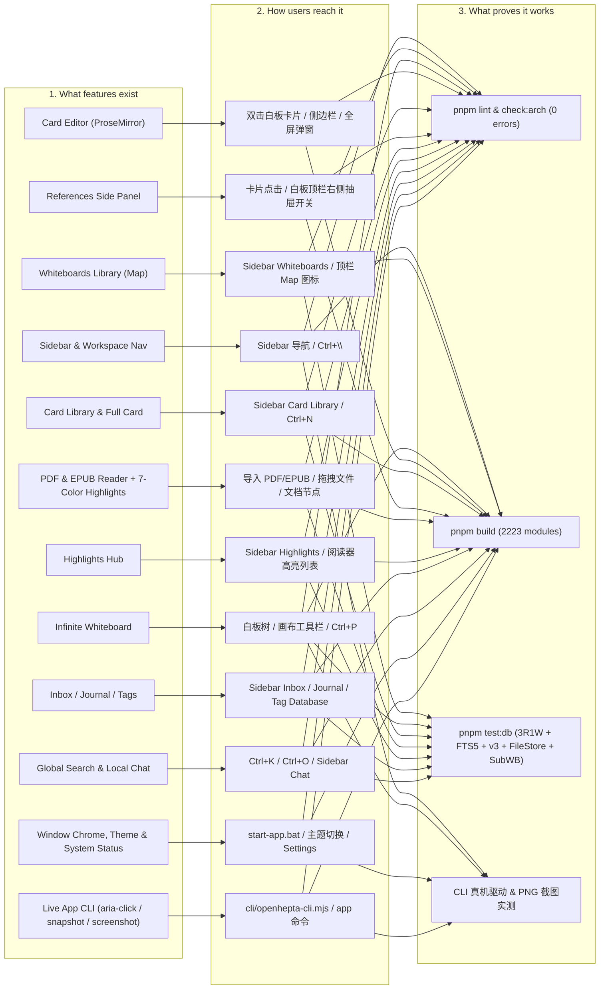

# OpenHepta Feature & Function Map

本文档将 **Feature Map**（功能存在性 → 用户触达路径 → 验证证据）与 **Function Map**（各分层导出符号、领域 API 与模块职责）统一汇总于一处。

---

## 第一部分：Feature Map（What features exist → How users reach it → What proves it works）

| What features exist（功能模块） | How users reach it（用户触达路径与底层 API） | What proves it works（验证依据） |
| :--- | :--- | :--- |
| **1. 左侧边栏与导航** (`features/sidebar`) | 窗口常驻左侧；拖拽右边缘调宽（`256–480px`）、`Ctrl+\` / 折叠按钮收起；点击工作区切换、模式切换或多层级白板树（支持嵌套子白板树状缩进、折叠展开手柄、悬停 `+` 快速创建子白板、拖拽重排父子层级与 `Move to root`，`heptaClient.whiteboards.moveHierarchy`） | `pnpm lint`（`002-feature-and-layering` 隔离通过）；`pnpm build`；`pnpm test:db`；CLI `snapshot` 实测可见子白板树、折叠控件与新建子白板跳转 |
| **2. 白板库汇总页** (`features/whiteboards-library`) | 点击 Sidebar **Whiteboards** 或白板顶栏左上角 Map 图标进入 `'map'` 视图；支持 Grid 实时配色 SVG 缩略小地图、Table 视图、置顶、复制与 `useAppModal` 递归软删除（保留所有卡片，`heptaClient.whiteboards.getStatsMap/duplicate/delete`） | `pnpm lint`、`npx tsc --noEmit`、`pnpm build` 通过；修复 Section 配色后白板库真实渲染分区/卡片/连线色彩 |
| **3. 无限白板画布与嵌入子白板** (`features/whiteboard`) | 启动默认进入或点击任意白板进入；左侧浮动工具栏建卡/分区/导图/导入文档/快捷键 `W` 或框选创建嵌入子白板（`SubWhiteboardNode`，`isChild: true` 默认 `640×420`，支持 8 向缩放与 `128px` 折叠吸附、内联重命名、8 色背景与 `Fit to content`）及白板快捷方式（`isChild: false` 固定 `640×128` 与 `Shortcut` 徽章）；支持分区菜单 `Turn into sub-whiteboard`、多选 `Pack into Sub-whiteboard`、画布拖拽投递入子白板（`Alt` 复制自动降级为快捷方式、DAG 环路检测拦截、底部 `"Moved N item(s)"` + `View` 跳转条）、`Ctrl+C`/`Ctrl+V` 自动降级为快捷方式与删除区分确认；支持双击子白板深入下级、顶栏面包屑（`WhiteboardBreadcrumb`）层级返回；Shift 框选、30% LOD 缩放降级、三次贝塞尔/直线/折线连线与双层高亮选中、`Ctrl+P` 室内检索；右下角视图控制栏（贴齐 `bottom-1 right-1`）：包含 **Options** 菜单（`w-[248px]` 无滚动条 5 项：`Full title for folded cards`、`Large text at small zoom`、`Show mention link`、`Minimap`、`Focus mode` 含 `Connection depth` 0–5 与 `Fade other objects` 0–100% 滑块）、**Navigation mode**（随模式动态显示鼠标/触控板图标，切换 `Mouse navigation` / `Trackpad navigation`）、**Zoom to fit** 缩放百分比（`Shift+1`）与 **Zoom in / Zoom out**，配置持久化至 `wb.options_json`（`heptaClient.whiteboards.moveObjectsAcross/moveHierarchy/*`） | `pnpm lint`（0 warnings）、`pnpm build`、`pnpm test:db` 通过；CLI 真机端到端实测通过：创建 `640×420` 嵌入子白板与 `640×128` 白板快捷方式、Section 一键转为子白板、切换 `Preview`/`List` 视图、`WhiteboardBreadcrumb` 层级返回，以及右下角控制栏 `Options` / `Navigation mode` / `Zoom to fit` / `Zoom in` / `Zoom out` 真机交互与截图验证 |
| **4. ProseMirror 卡片编辑器** (`primitives/card-editor`) | 双击白板卡片正文、在右侧抽屉/全屏弹窗/Journal 中点击正文进入；无静态顶栏，通过行级 6 点把手、划词气泡栏、`/` 斜杠菜单、`[[` 双链补全、`$`/`$$` 公式、GFM 表格触发 | `npx tsc --noEmit`、`pnpm build`（含 KaTeX 字体与 `prosemirror-tables` 打包）；Markdown ⇄ ProseMirror 往返冒烟测试通过 |
| **5. 卡片库与全屏卡片** (`features/card-library`) | 点击 Sidebar **Card Library** 或 `Ctrl+N` 新建；支持 Grid/Table/List、标签/白板/颜色筛选、批量操作、`Documents` 页签，点击卡片打开 `FullCardModal`（`heptaClient.cards.*` / `documents.*`） | `pnpm lint`（0 原生 `confirm()` 残留）、`npx tsc --noEmit`、`pnpm build`、`pnpm test:db` 通过 |
| **6. 右侧 References 卡片栈抽屉** (`features/card-drawer`) | 点击任意卡片的「侧栏打开」或白板顶栏右侧抽屉按钮；支持左边缘调宽、`150px` 阻尼收起、多卡堆叠折叠/拖拽重排、标签与 `Linked/Unlinked` 反链面板 | `pnpm lint`、`npx tsc --noEmit`、`pnpm build` 通过 |
| **7. PDF + 原生 EPUB 阅读与 7 色高亮** (`features/reader`) | 白板左侧栏导入或直接拖入 `.pdf`/`.epub`、卡片库 `Import PDF/EPUB` / 点击 `Open document: <title>` 卡片或双击文档节点；使用 `pdfjs-dist/legacy/build` 与 `epubjs` 渲染，`PdfReader` 支持文本划线与可拖拽移动/8 向手柄缩放的 `Area Crop` 框选区域（调整后自动重截高清截图并落盘 `rects_json`），`EpubReader` 工具栏与 `Previous Page` / `Current page` / `Next Page` 页码位置及位置持久化与 `PdfReader` 一致（`heptaClient.documents/highlights/localFile`） | `pnpm lint`、`pnpm build` 与 `pnpm test:db` 通过；CLI 真机打开 PDF 点击 `Area Crop` 按钮并拖拽验证、EPUB `snapshot` 与 `screenshot` 实测通过 |
| **8. 全局高亮汇总与原位置跳回** (`features/highlights`) | 点击 Sidebar **Highlights**；按 `All / PDF / EPUB / Cards` 与 7 色筛选，点击 `Open at page X` / `Locate in EPUB` 直接定位回阅读器对应页码或 CFI | `pnpm lint`、`npx tsc --noEmit`、`pnpm build` 通过 |
| **9. Inbox / Journal / Tags** (`features/inbox`, `journal`, `tags`) | 点击 Sidebar 对应导航项；Inbox 快速捕获未入板碎片、Journal 按日写日记（`journal-YYYY-MM-DD`）、Tags 管理标签数据库（支持 Table 全量表、Kanban 看板、Cards 纯卡片网格与 Highlights 纯高亮标注面板四视图，支持直接添加到白板与跳回原文献，`heptaClient.cards/tags/highlights`） | `pnpm lint`、`npx tsc --noEmit`、`pnpm build`、`pnpm test:db` 通过；CLI 真机切换 `Highlights view` 截图验证通过 |
| **10. 全局搜索与本地对话** (`features/search`, `chat`) | `Ctrl+K` / `Ctrl+O` 或点击 Sidebar 搜索框唤起快速检索；点击 Sidebar **Chat** 进入本地 FTS5 知识问答（`heptaClient.cards.searchFts`） | `pnpm lint`、`pnpm build`、`pnpm test:db`（FTS5 虚拟表匹配测试通过） |
| **11. 窗口壳、主题与系统诊断** (`electron-main/startup`, `features/system-status`) | 双击 `start-app.bat` 启动（自动清除 `ELECTRON_RUN_AS_NODE`）；隐藏菜单栏（`Alt` 呼出）、自定义应用图标、底部齿轮/月亮切换明暗主题联动原生标题栏与 3R1W/通知/更新诊断 | `pnpm lint`、`pnpm build`、`pnpm test:db` 通过；CLI 点击 `Settings` 后实测截图展示 `3 Threads`、`1 FIFO Queue`、`Port 48921` |
| **12. 实时应用控制 CLI** (`cli/`, `electron-main/cli/`) | 终端执行 `node cli/openhepta-cli.mjs`（或 `pnpm link --global` 后执行 `app`）：通用驱动（`launch`、`aria-click`、`aria-drag`、`aria-type`、`aria-set-value`、`snapshot`、`screenshot`）与全功能领域命令（`nav`、`whiteboard`、`mindmap`、`card`、`drawer`、`document`、`highlight`、`inbox`、`journal`、`tag`、`search`、`system`） | 真机端到端实测通过：全 12 个功能领域 CLI 命令连通 `48921` 实时读写 SQLite 并驱动 Electron 渲染层热刷新，配合 `snapshot` 与 `screenshot` 完成闭环验收 |

---

## 第二部分：Function Map（模块符号与 API 映射）

### 1. 跨端共享契约层（`shared/`）

| 文件 | 导出符号 | 职责说明 |
| :--- | :--- | :--- |
| [shared/types.ts](./shared/types.ts) | `Card`, `Whiteboard`, `WhiteboardOptions`, `WhiteboardObject`, `SubWhiteboardProperties`, `WhiteboardChildItemSummary`, `MoveObjectsAcrossWhiteboardsInput`, `MoveObjectsAcrossWhiteboardsResult`, `MoveWhiteboardHierarchyInput`, `MoveWhiteboardHierarchyResult`, `Connection`, `Tag`, `DocumentRecord`, `HighlightElement`, `PickedDocumentFile`, `LocalFileReference`, `LocalFileInstance`, `AppNotification`, `AppUpdateState`, `SystemDiagnosticsState`, `HEPTA_DEFAULT_DIMENSIONS` | 核心领域实体、嵌入子白板/快捷方式与跨板迁移/层级重排契约、白板选项配置契约、IPC 请求参数、默认节点尺寸矩阵（含 `sub_whiteboard` `640×420` 与 `whiteboard_shortcut` `640×128`） |
| [shared/api.ts](./shared/api.ts) | `IPC_CHANNELS`, `HeptaCardsApi`, `HeptaWhiteboardsApi`, `HeptaDocumentsApi`, `HeptaHighlightsApi`, `HeptaTagsApi`, `HeptaLocalFileApi`, `HeptaNotificationsApi`, `HeptaUpdateApi`, `HeptaSystemApi`, `HeptaElectronApi` | 主/渲染进程强类型 IPC 通道常量与全功能领域 API 契约 |
| [shared/palette.ts](./shared/palette.ts) | `HEPTA_CARD_PALETTE`, `resolveCardBgColor`, `HEPTA_SECTION_COLORS`, `HEPTA_SECTION_PALETTE`, `resolveSectionColors`, `ANNOTATION_COLORS`, `ANNOTATION_COLOR_MAP`, `getAnnotationCssVar`, `resolveAnnotationColorHex`, `isAnnotationColor`, `toExactArrayBuffer`, `parseHighlightRects` | 卡片 8 色、分区 8 色 HSL、批注 7 色映射与矩形解析纯函数 |

### 2. Electron 主进程（`electron-main/`）

#### 2.1 启动、宿主与 CLI 服务

| 文件 | 导出函数 / 常量 | 职责说明 |
| :--- | :--- | :--- |
| [main.ts](./electron-main/main.ts) | — | 主进程入口：调用 `setupProcessErrorHandlers()` 与 `bootstrapAppLifecycle()` |
| [preload.ts](./electron-main/preload.ts) | — | 通过 `contextBridge.exposeInMainWorld('heptaElectronApi', ...)` 暴露 `HeptaElectronApi` |
| [appLifecycle.ts](./electron-main/startup/appLifecycle.ts) | `setupProcessErrorHandlers`, `bootstrapAppLifecycle` | 单实例锁、协议注册、存储与 API 初始化、CLI 服务启停、窗口创建与退出清理 |
| [windowManager.ts](./electron-main/startup/windowManager.ts) | `createWindow`, `focusOrCreateWindow`, `getMainWindow`, `clearMainWindow`, `initNativeThemeSync`, `applyNativeTheme`, `readSavedTheme`, `saveTheme`, `resolveAppIcon`, `ROOT_DIR` | 多窗口管理、`autoHideMenuBar`、图标加载、`theme-config.json` 与 `nativeTheme` 同步 |
| [menu.ts](./electron-main/startup/menu.ts) | `buildAndSetApplicationMenuOnce`, `setupWindowsTaskList` | 原版对齐应用菜单（`Ctrl+Shift+N` / `Ctrl+Shift+W` / `Ctrl+=`）与 Windows Jump List |
| [protocols.ts](./electron-main/startup/protocols.ts) | `registerPrivilegedSchemes`, `registerProtocols` | 注册 `hepta-file://` 与 `hepta-preview://` 协议，支持 HTTP `Range` (`206`) 流式读取 |
| [storage.ts](./electron-main/startup/storage.ts) | `initStorage`, `getFileStore`, `requireFileStore`, `cleanupStorage` | 初始化与清理 `dbMaster`（3R1W SQLite）和 `LocalFileStore` |
| [cliServer.ts](./electron-main/cli/cliServer.ts) | `startCliServer`, `stopCliServer`, `getCliServerStatus` | 本地 HTTP 控制桥（`127.0.0.1:48921`），支持 `/health`、`/snapshot`（含 `switch`/`slider` 状态）、`/aria-click`、`/aria-type`、`/aria-set-value`、`/screenshot` |

#### 2.2 领域 IPC API 处理器（`electron-main/api/`）

| 文件 | 导出注册函数 | 对应前端 `heptaClient` 域 |
| :--- | :--- | :--- |
| [api/index.ts](./electron-main/api/index.ts) | `registerAllApiHandlers` | 统一注册以下全部 7 个领域 API 处理器 |
| [cardsApi.ts](./electron-main/api/cardsApi.ts) | `registerCardsApiHandlers` | `cards`: 卡片 CRUD、FTS5 检索、Inbox、Journal、标签、反链与未链接提及 |
| [whiteboardsApi.ts](./electron-main/api/whiteboardsApi.ts) | `registerWhiteboardsApiHandlers` | `whiteboards`: 白板 CRUD/递归软删除（保卡）/克隆/视口、白板对象与连线 CRUD、批量更新、跨白板迁移 `moveObjectsAcross`（分区递归展开 + DAG 环检测 + 坐标重映射 + 连线拓扑拆分 + 复制降级）、层级重排 `moveHierarchy`、缩略图与 `itemSummaries` 聚合统计 |
| [documentsApi.ts](./electron-main/api/documentsApi.ts) | `registerDocumentsApiHandlers` | `documents`: PDF / EPUB 文档入库、阅读进度与封面更新、软删除 |
| [highlightsApi.ts](./electron-main/api/highlightsApi.ts) | `registerHighlightsApiHandlers` | `highlights`: 7 色文本/区域高亮查询、创建、批注编辑、变色与删除 |
| [tagsApi.ts](./electron-main/api/tagsApi.ts) | `registerTagsApiHandlers` | `tags`: 标签计数列表、创建/删除、按标签检索卡片与绑定解绑 |
| [localFileApi.ts](./electron-main/api/localFileApi.ts) | `registerLocalFileApiHandlers` | `localFile`: 文件导入、PDF/EPUB 选择对话框、Buffer 读取、截图落盘、外链打开 |
| [systemApi.ts](./electron-main/api/systemApi.ts) | `registerSystemApiHandlers` | `system` / `notifications` / `update`: CLI 状态、诊断信息、主题/新窗口、通知与更新检查 |

#### 2.3 存储、通知与更新服务

| 文件 | 导出符号 | 职责说明 |
| :--- | :--- | :--- |
| [dbMaster.ts](./electron-main/database/dbMaster.ts) | `dbMaster` | 3R1W（3 Reader Workers + 1 Writer Worker）SQLite 调度器 |
| [dbWorker.ts](./electron-main/database/dbWorker.ts) | — | Worker 线程 SQLite WAL 执行器 |
| [migrations.ts](./electron-main/database/migrations.ts) | `Migration`, `migrations` | v1 核心表、v2 FTS5 触发器、v3 `documents` & `highlight_elements` |
| [LocalFileStore.ts](./electron-main/local-file/LocalFileStore.ts) | `LocalFileStore` | SHA-256 去重文件存储、Buffer 读取、PNG 截图落盘与 `local-file-mvp.sqlite` |
| [notificationService.ts](./electron-main/notifications/notificationService.ts) | `sendAppNotification`, `listRecentNotifications` | 原生桌面通知发送与最近通知历史队列 |
| [updateService.ts](./electron-main/update/updateService.ts) | `getUpdateState`, `checkForAppUpdates` | 当前应用版本与更新检查状态服务 |

### 3. Electron 渲染进程（`electron-renderer/src/`）

#### 3.1 客户端 API 层（`client/`）与编排外壳（`App.tsx`）

| 文件 | 导出符号 | 职责说明 |
| :--- | :--- | :--- |
| [client/ipcBridge.ts](./electron-renderer/src/client/ipcBridge.ts) | `heptaClient` | 唯一访问 `window.heptaElectronApi` 的模块，暴露全领域强类型 API |
| [client/index.ts](./electron-renderer/src/client/index.ts) | `heptaClient` | 客户端层统一出口 |
| [App.tsx](./electron-renderer/src/App.tsx) | `App` (default) | App Framework：全局视图切换、主题同步、白板/卡片/阅读器/抽屉状态编排 |

#### 3.2 跨 Feature 底层原语（`primitives/`）

| 目录 / 文件 | 导出符号 | 职责说明 |
| :--- | :--- | :--- |
| [AppModal.tsx](./electron-renderer/src/primitives/AppModal.tsx) | `AppModalProvider`, `useAppModal`, `ModalDialog` | 多模态对话框（Alert / Confirm / Prompt） |
| [canvas-math/coordinate.ts](./electron-renderer/src/primitives/canvas-math/coordinate.ts) | `screenToWorld`, `worldToScreen`, `getVisibleWorldBounds`, `isObjectInViewport`, `getCubicBezierPath`, `getStraightPath`, `getElbowPath`, `getConnectionPath` | 画布坐标变换、视口裁剪与贝塞尔/折线/直线路径生成 |
| [canvas-math/layoutAlgorithms.ts](./electron-renderer/src/primitives/canvas-math/layoutAlgorithms.ts) | `computeBoundingBox`, `alignObjects`, `arrangeObjects`, `lintWhiteboard`, `computeSmartGuides` | 白板对齐、自动排布、智能吸附参考线与画布体检 |
| [canvas-math/mindmapLayout.ts](./electron-renderer/src/primitives/canvas-math/mindmapLayout.ts) | `computeMindMapLayout`, `applyMindMapOperation`, `navigateMindMapByArrow`, `parseOrMigrateMindMapData`, `createDefaultMindMapData`, `getMindMapEdgePath` | 水平/垂直双向思维导图排版引擎、原子操作（含环检测、300 节点上限与分支配色级联）、方向键导航与旧版树无损迁移 |
| [card-editor/CardEditor.tsx](./electron-renderer/src/primitives/card-editor/CardEditor.tsx) | `CardEditor`, `CardEditorProps` | 原生 ProseMirror 富文本卡片编辑器主体 |
| [prosemirror/schema.ts](./electron-renderer/src/primitives/card-editor/prosemirror/schema.ts) | `heptaSchema`, `EDITOR_PALETTE` | ProseMirror 节点与标记 Schema（含表格、公式、媒体、Callout、Toggle 等） |
| [prosemirror/serializer.ts](./electron-renderer/src/primitives/card-editor/prosemirror/serializer.ts) | `docToJson`, `docFromJson`, `docToPlainText`, `docFromPlainText`, `docToHtml`, `extractCardIdsFromDoc`, `docFromMarkdown`, `docToMarkdown` | ProseMirror JSON ⇄ Markdown ⇄ PlainText ⇄ HTML 互转与双链提取 |
| [prosemirror/commands.ts](./electron-renderer/src/primitives/card-editor/prosemirror/commands.ts) | `TURN_INTO_ITEMS`, `applyBlockType`, `applyBlockTypeAtPos`, `duplicateBlockAtPos`, `deleteBlockAtPos`, `moveBlock`, `insertTable`, `insertMathDisplay`, `insertMathInline`, `insertImageBlock`, `insertVideoBlock`, `insertCardChip`, `insertDateChip`, `setColor`, `setLink` | 块级转换、增删复制、表格/公式/媒体/双链插入命令 |
| [prosemirror/FloatingOverlays.tsx](./electron-renderer/src/primitives/card-editor/prosemirror/FloatingOverlays.tsx) | `BlockContextMenu`, `BubbleToolbar`, `LinkPopover`, `SlashMenu`, `MentionMenu`, `TableToolbar`, `SLASH_COMMAND_ITEMS` | 五大浮动编辑图层与表格浮动工具条 |
| [prosemirror/plugins.ts](./electron-renderer/src/primitives/card-editor/prosemirror/plugins.ts) | `placeholderPlugin`, `inlineTagHighlightPlugin`, `detectEditorTrigger` | 占位符、`#tag` 内联装饰与 `/` / `[[` 触发器检测 |
| `prosemirror/CodeBlockView.ts` / `MathNodeView.ts` / `MediaNodeViews.ts` | `HeptaCodeBlockView`, `HeptaMathView`, `HeptaImageView`, `HeptaVideoView` | 代码块、KaTeX 公式、图片与视频 NodeView |
| [card-metadata/CardTagsPropertiesBar.tsx](./electron-renderer/src/primitives/card-metadata/CardTagsPropertiesBar.tsx) | `CardTagsPropertiesBar` | 卡片内联标签、属性与统计信息栏 |
| [card-metadata/CardBacklinksSection.tsx](./electron-renderer/src/primitives/card-metadata/CardBacklinksSection.tsx) | `CardBacklinksSection` | 卡片底部 Linked / Unlinked 反链区块 |

#### 3.3 业务 Feature 模块（`features/` — One Folder Per Feature）

| Feature 目录 | 核心导出组件 | 功能说明 |
| :--- | :--- | :--- |
| [features/sidebar/](./electron-renderer/src/features/sidebar/Sidebar.tsx) | `Sidebar`, `SidebarProps`, `SidebarView` | 左侧导航栏（拖拽调宽、平滑折叠、工作区切换、Pinned/白板树、快捷键） |
| [features/whiteboard/](./electron-renderer/src/features/whiteboard/WhiteboardCanvas.tsx) | `WhiteboardCanvas`, `WhiteboardHeader`, `WhiteboardCardNode`, `SubWhiteboardNode`, `SectionNode`, `MindmapNode`, `MediaNode`, `ConnectionLayer`, `DocumentNode`, `HighlightNode` | 无限白板画布、嵌入子白板与快捷方式节点（List/Preview 双模、拖拽投递、分区/多选转换）、双向思维导图与多类型文件资产上传（Image/Video/Audio/PDF/EPUB/Markdown）、LOD 降级、框选、Focus Mode、分区/文档/高亮节点与双层高亮连线 |
| [features/whiteboards-library/](./electron-renderer/src/features/whiteboards-library/WhiteboardsView.tsx) | `WhiteboardsView` | 白板库汇总页（Grid 实时配色 SVG 缩略小地图 + Table 视图、置顶/复制/删除） |
| [features/card-library/](./electron-renderer/src/features/card-library/CardLibraryView.tsx) | `CardLibraryView`, `FullCardModal` | 卡片库（Grid/Table/List、多维筛选与排序、批量操作、文档标签页）与全屏卡片弹窗 |
| [features/card-drawer/](./electron-renderer/src/features/card-drawer/CardDrawer.tsx) | `CardDrawer` | 右侧可停靠 References 多卡引用栈抽屉（拖拽调宽、阻尼收起、拖拽重排） |
| [features/reader/](./electron-renderer/src/features/reader/DocumentReaderShell.tsx) | `DocumentReaderShell`, `PdfReader`, `EpubReader`, `HighlightToolbar` | PDF（`pdfjs-dist/legacy/build` 文字划线 + 区域截图）与原生 EPUB（`epubjs` CFI 高亮）双模阅读器 |
| [features/highlights/](./electron-renderer/src/features/highlights/HighlightsView.tsx) | `HighlightsView` | 全局 7 色高亮汇总（PDF/EPUB/卡片筛选、内联笔记、添加到白板与原位置跳回） |
| [features/inbox/](./electron-renderer/src/features/inbox/InboxView.tsx) | `InboxView` | 未归类灵感碎片收集箱 |
| [features/journal/](./electron-renderer/src/features/journal/JournalView.tsx) | `JournalView` | 按日导航的每日随手记 |
| [features/tags/](./electron-renderer/src/features/tags/TagsView.tsx) | `TagsView` | 标签库管理与按标签关联卡片 |
| [features/search/](./electron-renderer/src/features/search/GlobalSearchModal.tsx) | `GlobalSearchModal` | 全局快速检索弹窗（`Ctrl+K` / `Ctrl+O`，FTS5 卡片与白板直达） |
| [features/chat/](./electron-renderer/src/features/chat/ChatView.tsx) | `ChatView` | 本地知识库检索对话视图 |
| [features/system-status/](./electron-renderer/src/features/system-status/SystemStatusView.tsx) | `SystemStatusView` | 3R1W 存储拓扑、CLI 状态、通知记录与更新检查视图 |

### 4. CLI、架构校验与 TLA+ 形式化验证工具链（`cli/`、`lint-rules/`、`tla/`）

| 文件 | 导出 / 职责 |
| :--- | :--- |
| [cli/openhepta-cli.mjs](./cli/openhepta-cli.mjs) | 实时客户端控制命令行工具（详见 [cli/README.md](./cli/README.md)） |
| [lint-rules/index.mjs](./lint-rules/index.mjs) | `buildEslintConfig`, `astImportAnalyzers`, `astNodeAnalyzers`, `checkCodeComments`, `checkCssComments` |
| [lint-rules/check-architecture.mjs](./lint-rules/check-architecture.mjs) | TypeScript AST 依赖图与无注释/禁裸SQL/禁裸IPC 独立校验入口（`pnpm check:arch`） |
| `lint-rules/001-` ~ `011-` | 详见 [lint-rules/docs.md](./lint-rules/docs.md) |
| [tla/run-tlc.mjs](./tla/run-tlc.mjs) | TLA+ / TLC 形式化模型检查运行器（`pnpm verify:tla`，全覆盖 `DbMaster3R1W`、`WhiteboardHierarchy`、`MindMapTree`、`CrossWhiteboardMove`、`LocalFileStoreCAS`、`CardTagHighlightLifecycle`、`ReferencesDrawerStack` 共 7 套规范，详见 [tla/README.md](./tla/README.md)） |

---

## 关联文档

- 架构规范：[AGENTS.md](./AGENTS.md)
- Lint 与依赖图规则：[lint-rules/docs.md](./lint-rules/docs.md)
- CLI 工具文档：[cli/README.md](./cli/README.md)
