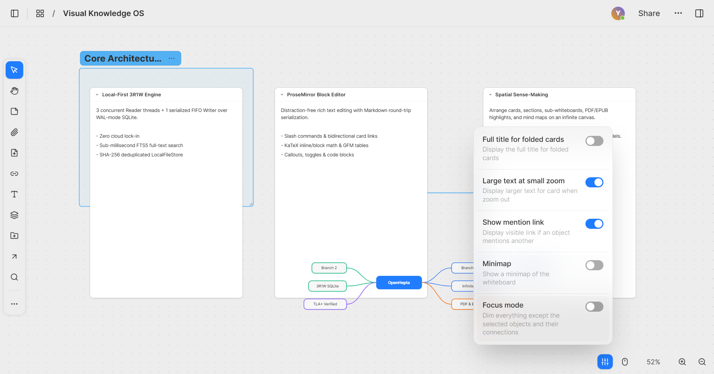
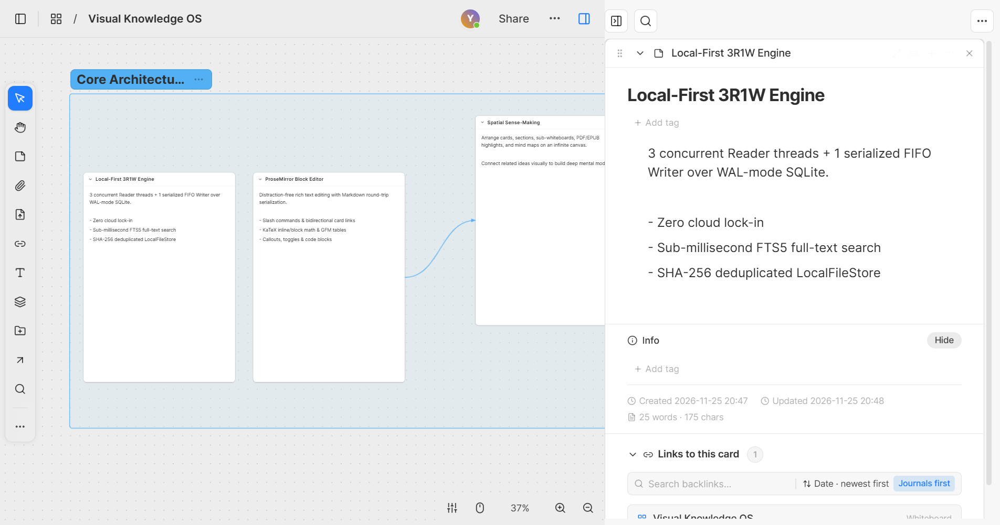
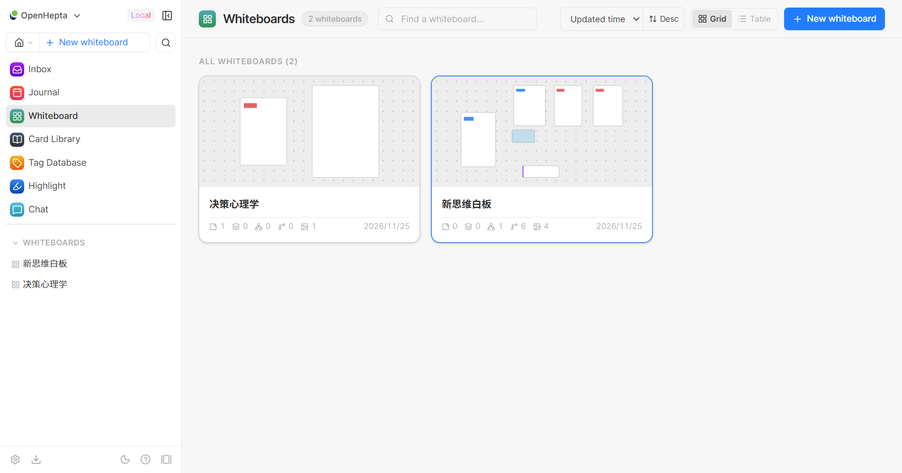
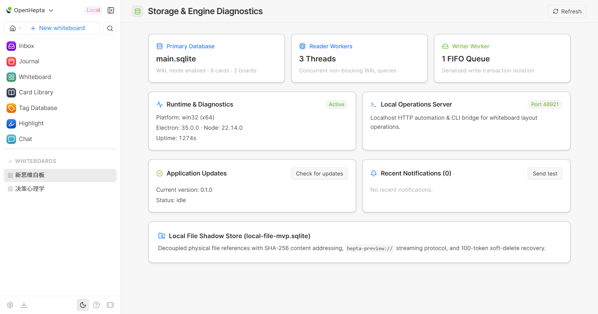

<div align="center">
  
  <h1>OpenHepta</h1>
  <p><strong>Heptabase のオープンソース・ローカルファースト実装</strong></p>
  <p>無限ホワイトボード、双方向マインドマップ、ProseMirror カードノート、ネイティブ PDF/EPUB 注釈を統合した高性能デスクトップ視覚的ナレッジ OS。</p>

  <p>
    <a href="./README.md">English</a> ·
    <a href="./README.zh-CN.md">简体中文</a> ·
    <strong>日本語</strong>
  </p>

  <p>
    
    
    
    
    
    
  </p>
</div>

<p align="center">
  
</p>

---

## OpenHepta とは？

**OpenHepta** は [Heptabase](https://heptabase.com/) のオープンソースかつローカルファーストなデスクトップ実装です。深い学習・研究・視覚的な思考整理のために設計されており、ノートカード、ホワイトボード、マインドマップ、PDF/EPUB 文献、7色ハイライトなどのすべてのデータをローカル環境のマルチスレッド SQLite データベースとコンテンツアドレス指定ファイルストアに 100% 保存します。クラウドロックインは一切ありません。

---

## 主な機能

### 1. 無限ホワイトボード・埋め込みサブホワイトボード・マインドマップ
- **空間キャンバス**：無限にズーム・パンできるキャンバス上に、カード、セクション、PDF/EPUB ドキュメントノード、ハイライト抜粋、メディア、テキストを自由に配置可能。30% LOD 描画、スマートガイド、3次ベジェ／直線／エルボー接続線を備えています。
- **埋め込みサブホワイトボードとショートカット**：サブホワイトボードのネスト（`640×420` リサイズ対応、`Preview` / `List` 切替）、セクションや複数選択オブジェクトのサブホワイトボード化、DAG 循環検出付きのボード間ドラッグ＆ドロップ移動、パンくずリストによる階層ナビゲーションに対応。
- **双方向マインドマップ**：水平／垂直レイアウトエンジン、ブランチごとの自動カラーリング、折りたたみ／展開、矢印キーによるフォーカス移動、CLI からのリアルタイム操作をサポート。
- **ビューポートコントロール**：フォーカスモード（接続深度 `0–5` と背景フェード調整）、ミニマップ、マウス／トラックパッド操作モード切替、ボードごとの設定永続化。

### 2. ネイティブ PDF & EPUB リーダーと 7色ハイライト
- **デュアルリーダー**：`pdfjs-dist` による PDF リーダーと `epubjs` によるネイティブ EPUB リーダーを内蔵し、右側のドッキング可能な分割ペインで文献を読みながらノートを整理できます。
- **テキストハイライト & Area Crop**：7色のテキストハイライトに加え、PDF ページ上で移動・8方向リサイズ可能な **Area Crop** 領域切り抜きを高解像度 PNG 抜粋として保存できます。
- **グローバルハイライトハブ**：PDF・EPUB・カード全体のハイライトをソース別や 7色でフィルタリングし、インラインメモの追記、ホワイトボードへの追加、元のページや EPUB CFI 位置へのワンクリックジャンプが可能です。

### 3. ProseMirror カードエディタ & References サイドパネル
- **リッチブロックエディタ**：ProseMirror ベースで、ドラッグハンドル、選択バブルツールバー、`/` スラッシュコマンド、`[[` 双方向カードリンク、KaTeX 数式（`$` / `$$`）、GFM テーブル、コードブロック、コールアウト、トグル、Markdown 双方向シリアライズに対応。
- **References ドロワー**：複数のカードや文献リーダーを右側のサイドパネルにスタック表示し、ドラッグ並べ替え、折りたたみ、タグ管理、`Linked / Unlinked` バックリンク参照を行えます。

<p align="center">
  
</p>

### 4. ホワイトボード一覧・カードライブラリ・Inbox・Journal・タグデータベース
- **ホワイトボードライブラリ**：リアルタイム配色 SVG ミニマップ付きの Grid ビューおよび Table ビューを備え、ピン留め、複製、カードを保持した再帰的ソフトデリートに対応。
- **カードライブラリ・Inbox・Journal**：Grid / Table / List での多角的なフィルタリング、Inbox での素早いメモ収集、日別ジャーナル（`journal-YYYY-MM-DD`）、4ビュー（Table / Kanban / Cards / Highlights）を備えたタグデータベースを提供。
- **グローバル検索 & ローカルチャット**：SQLite FTS5 による `Ctrl+K` / `Ctrl+O` の高速全文検索およびローカルナレッジ Q&A ビューを搭載。

<p align="center">
  
</p>

### 5. ローカルファースト 3R1W ストレージエンジン & リアルタイム CLI
- **3R1W SQLite アーキテクチャ**：WAL モードの SQLite（`main.sqlite`）上で 3つの並列 Reader ワーカースレッドと 1つの直列 FIFO Writer ワーカーを動作させ、大量データ操作時でも快適な UI 応答性を維持します。
- **SHA-256 ローカルファイルストア**：重複排除されたバイナリアセット管理（`local-file-mvp.sqlite`）と、`hepta-file://` および HTTP `206` Range ストリーミング対応の `hepta-preview://` カスタムプロトコルを採用。
- **内蔵ライブアプリ CLI**：ローカル HTTP ブリッジ（`127.0.0.1:48921`）経由で起動中の Electron ウィンドウを直接操作可能。全12ドメイン（`whiteboard`、`mindmap`、`card`、`document`、`highlight`、`tag`、`search`、`system` 等）と `aria-click` / `snapshot` / `screenshot` を備えています。

<p align="center">
  
</p>

---

## アーキテクチャと検証

- **厳格なレイヤー分離**：`electron-main/` と `electron-renderer/` 間の相互インポートを禁止し、共有型と IPC 契約を `shared/` に集約。レンダラーは **One Folder Per Feature** を徹底し、[lint-rules/check-architecture.mjs](./lint-rules/check-architecture.mjs) の AST 解析で自動検証しています。
- **TLA+ 形式検証**：3R1W 並行制御、サブホワイトボード DAG 非循環性、マインドマップ木不変条件、ボード間移動、SHA-256 CAS 参照カウント、カード／タグ／ハイライトのライフサイクル、References ドロワーのスタック不変条件を網羅する 7つの TLA+ 仕様を TLC（`pnpm verify:tla`）で検証しています。

---

## クイックスタート

### 動作要件
- **Node.js** `>= 20`
- **pnpm** `>= 9`

### インストールと開発起動

```bash
# 1. リポジトリをクローン
git clone https://github.com/heiye007/openhepta.git
cd openhepta

# 2. 依存関係をインストール
pnpm install

# 3. 開発モードで起動（Vite + Electron）
pnpm dev
```

### プロダクションビルド

```bash
# レンダラーと Electron メインプロセスをビルド
pnpm build
```

> **Windows でのヒント**：IDE の統合ターミナルから Electron を起動すると `ELECTRON_RUN_AS_NODE=1` が引き継がれて起動に失敗する場合があります。ルートディレクトリの [start-app.bat](./start-app.bat) をダブルクリックするか、`node cli/openhepta-cli.mjs launch` を使用すると環境変数が自動的にクリアされます。

---

## 検証・CLI コマンド

```bash
# ESLint および AST アーキテクチャ境界チェック
pnpm lint

# レンダラー／メインプロセスの型チェック
npx tsc --noEmit
npx tsc -p tsconfig.electron.json --noEmit

# 3R1W SQLite & LocalFileStore 結合テスト
pnpm test:db

# 全7種の TLA+ 形式モデル検査を実行
pnpm verify:tla

# 内蔵 CLI でデスクトップアプリを操作
node cli/openhepta-cli.mjs launch
node cli/openhepta-cli.mjs status
node cli/openhepta-cli.mjs whiteboard list
node cli/openhepta-cli.mjs snapshot
node cli/openhepta-cli.mjs screenshot proof.png
```

---

## ディレクトリ構成と関連ドキュメント

```text
open-hepta/
├── shared/               # プロセス間共有型、IPC 契約、カラーパレット
├── electron-main/        # メインプロセス、3R1W SQLite エンジン、LocalFileStore、API & CLI サーバー
├── electron-renderer/    # React UI、ProseMirror エディタ、PDF/EPUB リーダー、無限ホワイトボード
├── cli/                  # ライブアプリ自動操作 CLI（openhepta-cli.mjs）
├── lint-rules/           # ESLint & TypeScript AST 依存グラフ検証ルール
├── tla/                  # 7つの TLA+ 形式仕様と TLC 実行ランナー
└── assets/               # アプリアイコンおよびスクリーンショット
```

- アーキテクチャ規約：[AGENTS.md](./AGENTS.md)
- 機能・シンボルマップ：[FEATURE_MAP.md](./FEATURE_MAP.md)
- CLI リファレンス：[cli/README.md](./cli/README.md)
- Lint・依存関係ルール：[lint-rules/docs.md](./lint-rules/docs.md)
- TLA+ 形式検証：[tla/README.md](./tla/README.md)
- コントリビューションガイド：[CONTRIBUTING.md](./CONTRIBUTING.md)
- セキュリティポリシー：[SECURITY.md](./SECURITY.md)

---

## ライセンス

[MIT License](./LICENSE) の下で公開されています。

## 免責事項

Heptabase は Heptabase Inc. の商標です。**OpenHepta** は Heptabase の視覚的ナレッジ管理パラダイムに触発された独立したオープンソースプロジェクトであり、Heptabase Inc. とは提携しておらず、公式の承認を受けたものではありません。
