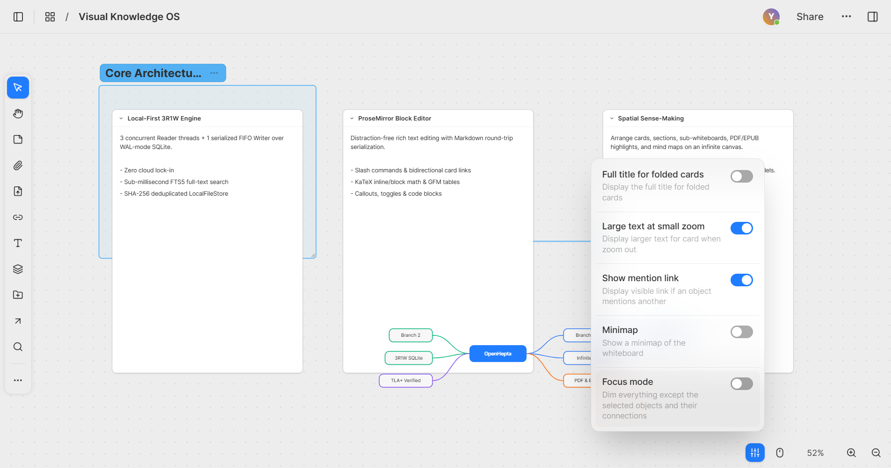
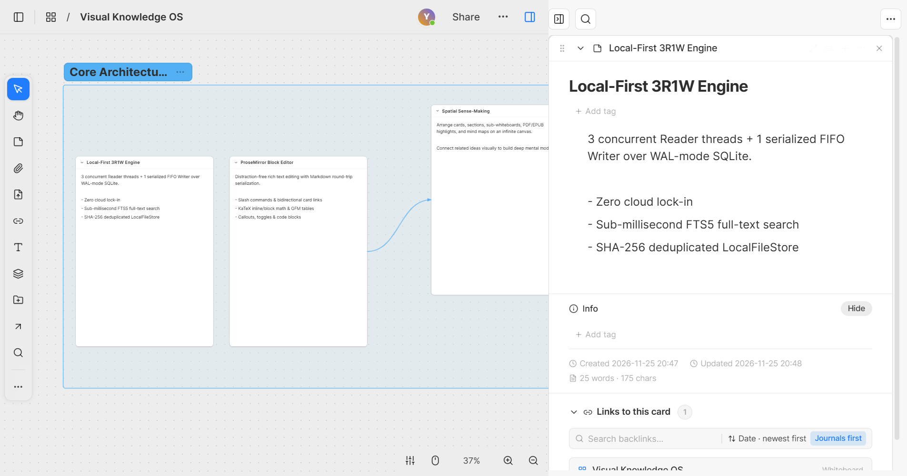
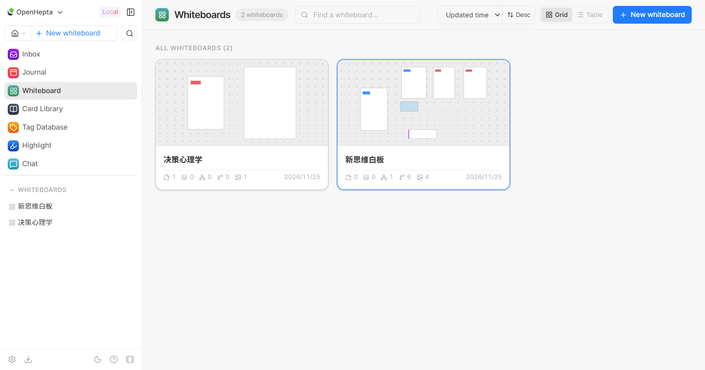
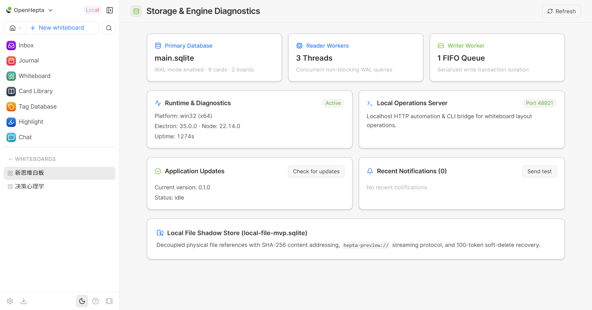

<div align="center">
  
  <h1>OpenHepta</h1>
  <p><strong>An open-source, local-first implementation of Heptabase</strong></p>
  <p>A high-performance desktop visual knowledge OS combining infinite whiteboards, bidirectional mind maps, ProseMirror card notes, and native PDF/EPUB annotation.</p>

  <p>
    <strong>English</strong> ·
    <a href="./README.zh-CN.md">简体中文</a> ·
    <a href="./README.ja.md">日本語</a>
  </p>

  <p>
    
    
    
    
    
    
  </p>
</div>

<p align="center">
  
</p>

---

## What is OpenHepta?

**OpenHepta** is an open-source, local-first desktop implementation of [Heptabase](https://heptabase.com/). Designed for deep learning, research, and visual sense-making, OpenHepta keeps all your notes, whiteboards, PDFs, EPUBs, and highlights 100% on your local machine in a fast multi-threaded SQLite database and content-addressed file store—with zero cloud lock-in.

---

## Key Features

### 1. Infinite Whiteboard, Nested Sub-Whiteboards & Mind Maps
- **Spatial Canvas**: Place cards, sections, PDF/EPUB document nodes, highlight excerpts, media assets, and freeform text on an infinite zoomable canvas with 30% LOD rendering, smart alignment guides, and cubic Bézier / straight / elbow connections.
- **Embedded Sub-Whiteboards & Shortcuts**: Nest sub-whiteboards (`640×420` resizable previews or `List`/`Preview` modes), pack multi-selected items or sections into sub-whiteboards, drag-and-drop objects across boards with automatic DAG cycle protection, and navigate seamlessly via breadcrumbs.
- **Bidirectional Mind Maps**: Built-in horizontal/vertical mind map layout engine with branch color cascading, collapse/expand, keyboard arrow navigation, and live CLI control.
- **Viewport Controls**: Focus mode (connection depth `0–5` and background fade), minimap toggle, mouse/trackpad navigation modes, and persistent per-board options.

### 2. Native PDF & EPUB Reader with 7-Color Highlights
- **Dual-Mode Reader**: Read PDF (`pdfjs-dist`) and EPUB (`epubjs`) books directly inside OpenHepta alongside your notes in a dockable split pane.
- **Text & Area Crop Highlights**: Highlight text in 7 annotation colors or capture resizable **Area Crop** regions on PDF pages as crisp PNG excerpts.
- **Global Highlights Hub**: Filter all highlights across PDFs, EPUBs, and cards by source or color, add inline notes, drop highlights onto any whiteboard, and jump straight back to the exact page or EPUB CFI location.

### 3. ProseMirror Card Editor & References Drawer
- **Rich Block Editor**: Built on ProseMirror with a distraction-free interface—drag handles, selection bubble toolbar, `/` slash commands, `[[` bidirectional card links, KaTeX inline/block math (`$` / `$$`), GFM tables, code blocks, callouts, toggles, and Markdown round-trip serialization.
- **References Side Panel**: Stack multiple cards and document readers in the dockable right drawer with drag-to-reorder, folding, tags, and Linked / Unlinked backlinks.

<p align="center">
  
</p>

### 4. Whiteboards Library, Card Library, Inbox, Journal & Tags
- **Whiteboards Library**: Browse all boards in Grid view with real-time colored SVG minimaps or Table view, with pinning, duplication, and card-preserving recursive soft delete.
- **Card Library, Inbox & Journal**: Manage notes in Grid / Table / List views, capture fleeting thoughts in Inbox, write daily entries (`journal-YYYY-MM-DD`) in Journal, and organize via Tag Databases (Table, Kanban, Cards, and Highlights views).
- **Global Search & Local Chat**: Instant `Ctrl+K` / `Ctrl+O` full-text search powered by SQLite FTS5, plus a local knowledge Q&A view.

<p align="center">
  
</p>

### 5. Local-First 3R1W Storage Engine & Live Automation CLI
- **3R1W SQLite Architecture**: 3 concurrent Reader worker threads + 1 serialized FIFO Writer worker over WAL-mode SQLite (`main.sqlite`), ensuring smooth UI responsiveness even during heavy indexing or batch operations.
- **SHA-256 Local File Shadow Store**: Deduplicated binary asset storage (`local-file-mvp.sqlite`) served via custom `hepta-file://` and `hepta-preview://` (HTTP `206` Range streaming) protocols.
- **Built-In Live App CLI**: Drive the running Electron window over `127.0.0.1:48921` for every feature domain (`whiteboard`, `mindmap`, `card`, `document`, `highlight`, `tag`, `search`, `system`, plus `aria-click`, `snapshot`, and `screenshot`).

<p align="center">
  
</p>

---

## Architecture & Engineering Rigor

OpenHepta enforces strict architectural boundaries and formal verification:

- **Strict Layer Isolation**: `electron-main/` and `electron-renderer/` cannot import each other; all cross-process contracts live in `shared/`. Renderer features follow **One Folder Per Feature** with zero cross-feature imports, enforced by custom AST rules in [lint-rules/check-architecture.mjs](./lint-rules/check-architecture.mjs).
- **Formal Verification (TLA+)**: 7 TLA+ specifications verified with TLC (`pnpm verify:tla`) covering 3R1W concurrency, sub-whiteboard DAG acyclicity, mind map tree invariants, cross-whiteboard moves, SHA-256 CAS reference counting, card/tag/highlight lifecycles, and References drawer stack invariants.

---

## Quick Start

### Prerequisites
- **Node.js** `>= 20`
- **pnpm** `>= 9`

### Installation & Development

```bash
# 1. Clone the repository
git clone https://github.com/heiye007/openhepta.git
cd openhepta

# 2. Install dependencies
pnpm install

# 3. Start in development mode (Vite + Electron)
pnpm dev
```

### Production Build

```bash
# Build renderer and Electron main process
pnpm build
```

> **Windows Tip**: If launching Electron from an IDE integrated terminal where `ELECTRON_RUN_AS_NODE=1` may be inherited, double-click [start-app.bat](./start-app.bat) or run `node cli/openhepta-cli.mjs launch`, both of which clear that environment variable automatically.

---

## Verification & CLI Commands

```bash
# Full lint & AST architecture boundary check
pnpm lint

# Type-check renderer & main process
npx tsc --noEmit
npx tsc -p tsconfig.electron.json --noEmit

# Run 3R1W SQLite & LocalFileStore integration tests
pnpm test:db

# Run all 7 TLA+ formal model checks
pnpm verify:tla

# Drive the running desktop app via CLI
node cli/openhepta-cli.mjs launch
node cli/openhepta-cli.mjs status
node cli/openhepta-cli.mjs whiteboard list
node cli/openhepta-cli.mjs snapshot
node cli/openhepta-cli.mjs screenshot proof.png
```

---

## Project Structure & Documentation

```text
open-hepta/
├── shared/               # Cross-process types, IPC contracts, and color palettes
├── electron-main/        # Main process, 3R1W SQLite engine, LocalFileStore, domain APIs & CLI server
├── electron-renderer/    # React UI, ProseMirror editor, PDF/EPUB readers, infinite whiteboard
├── cli/                  # Live desktop app automation CLI (openhepta-cli.mjs)
├── lint-rules/           # ESLint & TypeScript AST dependency graph rules
├── tla/                  # 7 TLA+ formal specifications & TLC runner
└── assets/               # App icon and screenshots
```

- Architecture Guide: [AGENTS.md](./AGENTS.md)
- Feature & Function Map: [FEATURE_MAP.md](./FEATURE_MAP.md)
- Live App CLI Reference: [cli/README.md](./cli/README.md)
- Architecture Lint Rules: [lint-rules/docs.md](./lint-rules/docs.md)
- TLA+ Formal Verification: [tla/README.md](./tla/README.md)
- Contributing Guide: [CONTRIBUTING.md](./CONTRIBUTING.md)
- Security Policy: [SECURITY.md](./SECURITY.md)

---

## License

Licensed under the [MIT License](./LICENSE).

## Disclaimer

Heptabase is a trademark of Heptabase Inc. **OpenHepta** is an independent, community-driven open-source project inspired by Heptabase's visual knowledge management paradigm and is not affiliated with or endorsed by Heptabase Inc.
