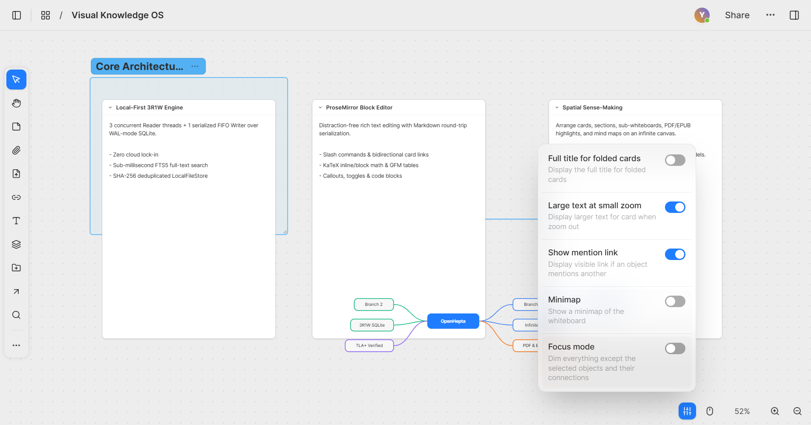
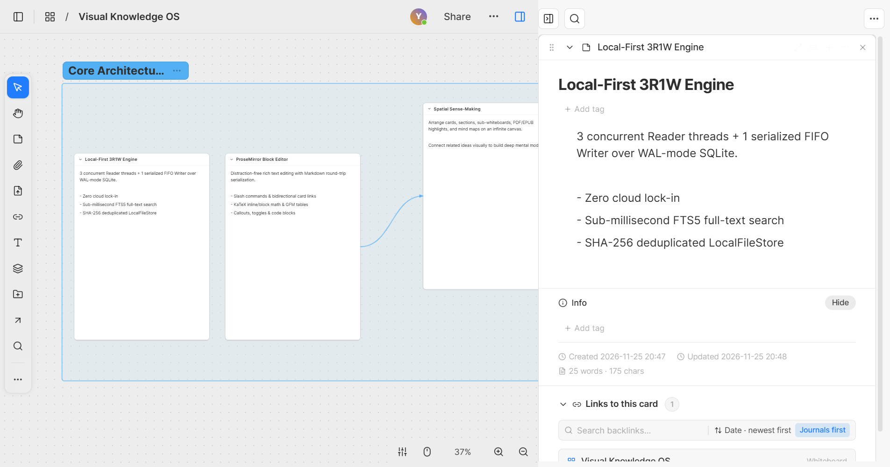
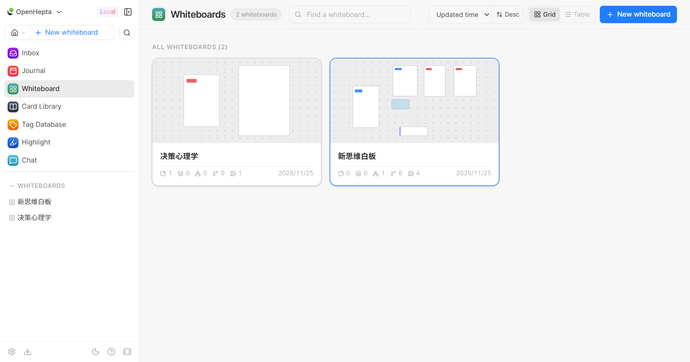
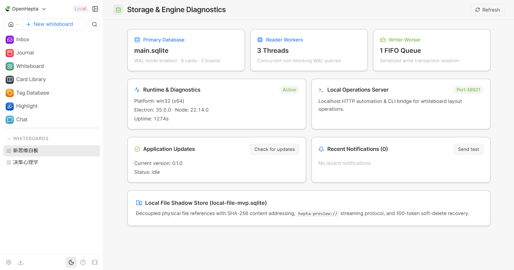

<div align="center">
  
  <h1>OpenHepta</h1>
  <p><strong>Heptabase 的开源、本地优先（Local-First）实现</strong></p>
  <p>高性能桌面端可视化知识工作台，集无限白板、双向思维导图、ProseMirror 卡片笔记与原生 PDF/EPUB 批注于一体。</p>

  <p>
    <a href="./README.md">English</a> ·
    <strong>简体中文</strong> ·
    <a href="./README.ja.md">日本語</a>
  </p>

  <p>
    
    
    
    
    
    
  </p>
</div>

<p align="center">
  
</p>

---

## 项目简介

**OpenHepta** 是 [Heptabase](https://heptabase.com/) 的开源本地优先桌面端实现。它专为深度学习、学术研究与可视化思考打造：你的所有卡片、白板、思维导图、PDF/EPUB 文献与 7 色高亮均 100% 存储在本地的多线程 SQLite 数据库与内容寻址文件库中，数据完全自主可控，无云端锁定。

---

## 核心功能

### 1. 无限白板、嵌入子白板与双向思维导图
- **空间画布**：在无限缩放的白板上自由排布卡片、分区（Section）、PDF/EPUB 文献节点、高亮摘录、多媒体与独立文本，支持 30% LOD 缩放降级、智能吸附参考线以及三次贝塞尔 / 直线 / 折线连线。
- **嵌入子白板与快捷方式**：支持嵌套子白板（默认 `640×420` 可缩放容器，支持 `Preview` / `List` 双视图）、分区一键转子白板、多选打包成子白板、跨白板拖拽投递（内置 DAG 环路检测拦截），并通过顶栏面包屑在层级间自由穿梭。
- **双向思维导图**：内置水平/垂直双模式思维导图排版引擎，支持分支配色级联、节点折叠/展开、方向键导航以及命令行实时操控。
- **视口控制栏**：支持 Focus Mode（连接深度 `0–5` 与背景淡化滑块）、小地图（Minimap）、鼠标/触控板导航切换与单板配置持久化。

### 2. 原生 PDF & EPUB 阅读器与 7 色高亮体系
- **双模分屏阅读**：内置基于 `pdfjs-dist` 的 PDF 阅读器与基于 `epubjs` 的原生 EPUB 阅读器，可在右侧可停靠分栏中边读边整理白板与卡片。
- **文字划线与区域截图（Area Crop）**：支持 7 色文本高亮，PDF 阅读器还支持可拖拽移动与 8 向缩放的 **Area Crop** 框选区域截图，自动落盘高清摘录。
- **全局高亮汇总（Highlights Hub）**：按 `All / PDF / EPUB / Cards` 与 7 色筛选全部标注，支持添加内联笔记、一键添加到白板，以及精准跳回 PDF 原页码或 EPUB CFI 位置。

### 3. ProseMirror 富文本卡片编辑器与右侧引用栈
- **无干扰块级编辑器**：基于 ProseMirror 构建，提供行级拖拽把手、划词气泡工具栏、`/` 斜杠菜单、`[[` 双链卡片补全、KaTeX 行内/块级数学公式（`$` / `$$`）、GFM 表格、代码块、Callout、折叠块与 Markdown 双向无损序列化。
- **References 卡片栈抽屉**：在右侧可停靠边栏中堆叠多张卡片与文献阅读器，支持拖拽调宽、折叠/重排、标签管理以及 `Linked / Unlinked` 反向链接面板。

<p align="center">
  
</p>

### 4. 白板库、卡片库、收集箱、日记与标签数据库
- **白板库（Whiteboards Library）**：提供带实时配色 SVG 缩略小地图的 Grid 视图与 Table 视图，支持置顶、克隆及保留卡片的递归软删除。
- **卡片库、Inbox 与 Journal**：支持 Grid / Table / List 多视图与多维筛选；Inbox 快速捕获未归类灵感；Journal 按日记录日记（`journal-YYYY-MM-DD`）；Tag Database 提供 Table、Kanban、Cards 与 Highlights 四种视图。
- **全局检索与本地对话**：`Ctrl+K` / `Ctrl+O` 唤起基于 SQLite FTS5 的毫秒级全局搜索，并内置本地知识库检索对话（Chat）视图。

<p align="center">
  
</p>

### 5. 本地优先 3R1W 存储引擎与实时应用 CLI
- **3R1W 多线程 SQLite 引擎**：在 WAL 模式下调度 3 个并发 Reader Worker 线程与 1 个串行 FIFO Writer Worker（`main.sqlite`），确保大量查询与写入场景下界面依然丝滑响应。
- **SHA-256 内容寻址影子资产库**：通过 `local-file-mvp.sqlite` 对本地文件进行去重管理，配合自定义 `hepta-file://` 与支持 HTTP `206` Range 流式读取的 `hepta-preview://` 协议高效加载大体积文献与媒体。
- **全功能实时 CLI 工具**：通过本地 HTTP 桥（`127.0.0.1:48921`）直接操控运行中的 Electron 桌面窗口，覆盖全部 12 个功能领域（`whiteboard`、`mindmap`、`card`、`document`、`highlight`、`tag`、`search`、`system` 等）以及 `aria-click`、`snapshot`、`screenshot` 真机验收能力。

<p align="center">
  
</p>

---

## 架构设计与工程规范

- **严格分层与水平隔离**：`electron-main/` 与 `electron-renderer/` 严禁相互导入，跨进程契约统一沉淀在 `shared/`；渲染层遵循 **One Folder Per Feature** 原则，禁止跨 Feature 互引，由 [lint-rules/check-architecture.mjs](./lint-rules/check-architecture.mjs) 在 AST 层强制检查。
- **TLA+ 形式化验证**：内置 7 套 TLA+ 规范（`pnpm verify:tla`），使用 TLC 模型检查器验证 3R1W 并发调度、子白板 DAG 无环、思维导图树不变式、跨白板迁移、SHA-256 资产引用计数、卡片/标签/高亮生命周期与右侧引用栈一致性。

---

## 快速开始

### 环境要求
- **Node.js** `>= 20`
- **pnpm** `>= 9`

### 安装与开发运行

```bash
# 1. 克隆仓库
git clone https://github.com/heiye007/openhepta.git
cd openhepta

# 2. 安装依赖
pnpm install

# 3. 启动开发模式（Vite + Electron）
pnpm dev
```

### 生产构建

```bash
# 构建渲染进程与 Electron 主进程
pnpm build
```

> **Windows 启动提示**：若在 IDE 集成终端中启动 Electron，可能因继承环境变量 `ELECTRON_RUN_AS_NODE=1` 导致启动异常。可直接双击根目录 [start-app.bat](./start-app.bat) 或运行 `node cli/openhepta-cli.mjs launch`（均已内置清除该环境变量）。

---

## 校验与 CLI 常用命令

```bash
# 全量 ESLint 与 AST 架构依赖图校验
pnpm lint

# 渲染进程与主进程 TypeScript 类型检查
npx tsc --noEmit
npx tsc -p tsconfig.electron.json --noEmit

# 运行 3R1W SQLite 与 LocalFileStore 集成测试
pnpm test:db

# 运行全部 7 套 TLA+ 形式化模型检查
pnpm verify:tla

# 使用内置 CLI 实时驱动桌面客户端
node cli/openhepta-cli.mjs launch
node cli/openhepta-cli.mjs status
node cli/openhepta-cli.mjs whiteboard list
node cli/openhepta-cli.mjs snapshot
node cli/openhepta-cli.mjs screenshot proof.png
```

---

## 目录结构与相关文档

```text
open-hepta/
├── shared/               # 跨进程共享类型、IPC 契约与配色常量
├── electron-main/        # 主进程、3R1W SQLite 引擎、LocalFileStore、领域 API 与 CLI 服务
├── electron-renderer/    # React 渲染层、ProseMirror 编辑器、PDF/EPUB 阅读器与无限白板
├── cli/                  # 实时桌面客户端控制命令行工具（openhepta-cli.mjs）
├── lint-rules/           # ESLint 与 TypeScript AST 依赖图规则
├── tla/                  # 7 套 TLA+ 形式化验证规范与 TLC 运行器
└── assets/               # 应用图标与界面截图
```

- 架构规范：[AGENTS.md](./AGENTS.md)
- 功能与符号映射：[FEATURE_MAP.md](./FEATURE_MAP.md)
- 实时 CLI 工具文档：[cli/README.md](./cli/README.md)
- 架构校验规则说明：[lint-rules/docs.md](./lint-rules/docs.md)
- TLA+ 形式化验证：[tla/README.md](./tla/README.md)
- 贡献指南：[CONTRIBUTING.md](./CONTRIBUTING.md)
- 安全策略：[SECURITY.md](./SECURITY.md)

---

## 开源协议

本项目基于 [MIT License](./LICENSE) 开源。

## 免责声明

Heptabase 是 Heptabase Inc. 的商标。**OpenHepta** 是一个受 Heptabase 可视化知识管理理念启发而创建的独立开源项目，与 Heptabase Inc. 无任何隶属或官方背书关系。
